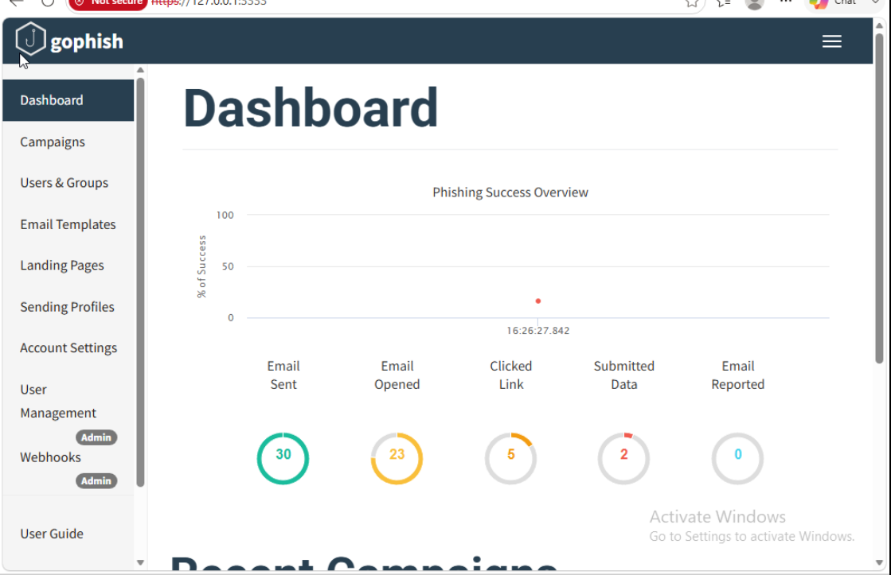
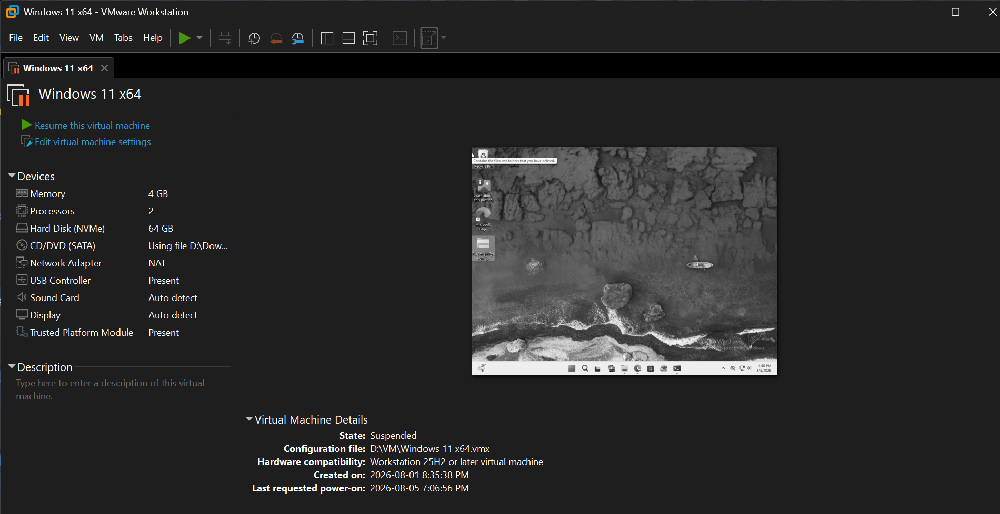
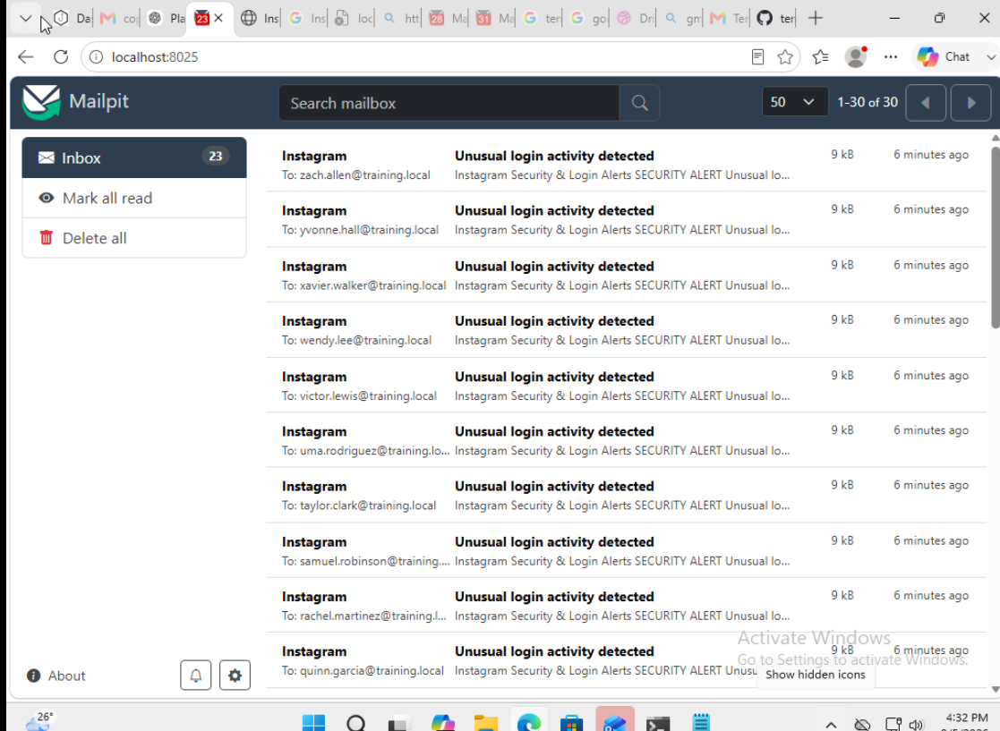
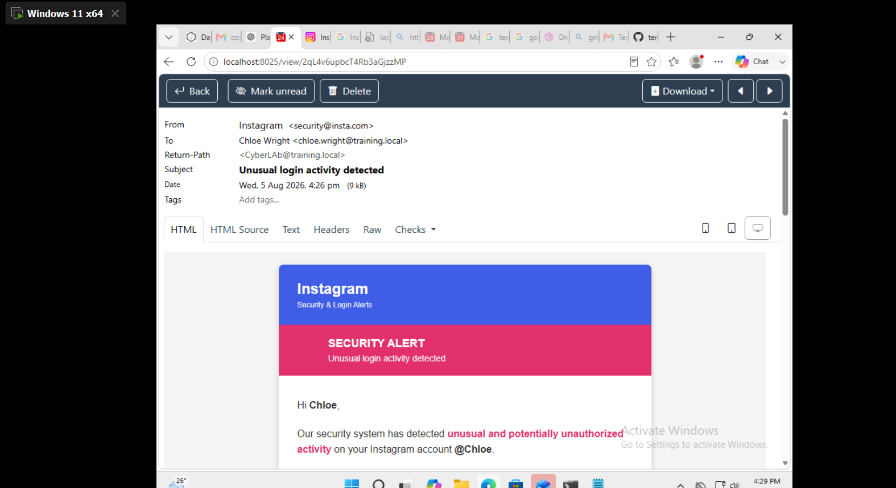
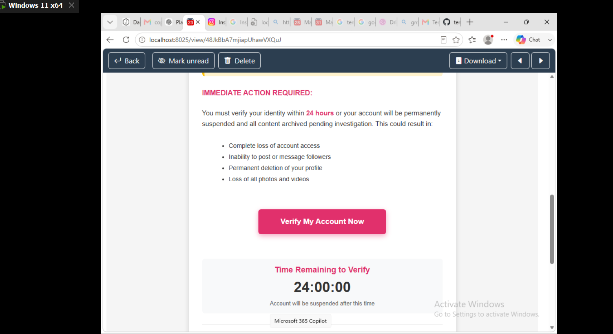
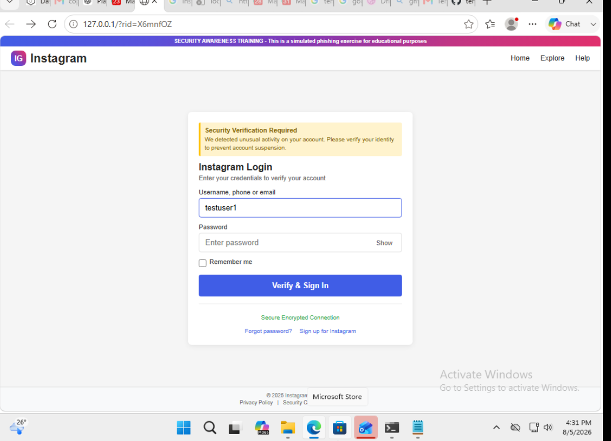
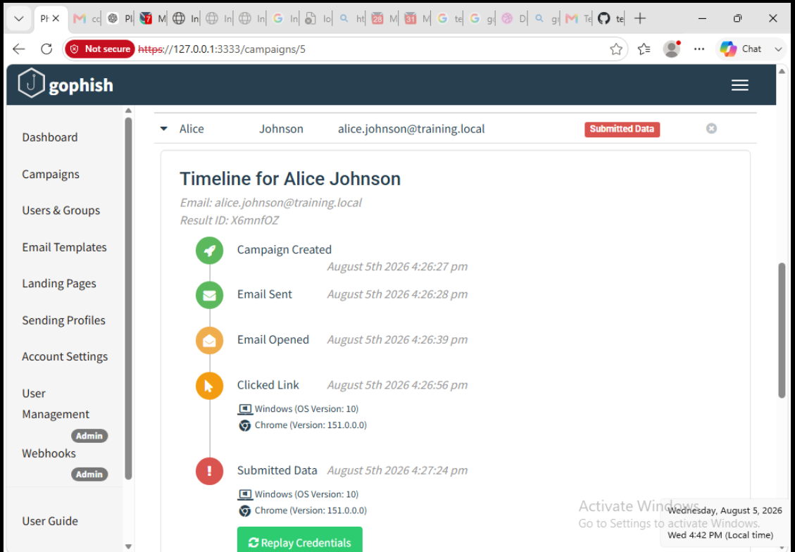

# Phishing Simulation & Security Awareness Testing
### Gophish | Mailpit | VMware Workstation | Windows 11

A hands-on cybersecurity lab demonstrating the design, deployment, monitoring, and evaluation of a **controlled phishing awareness campaign** using fictional users and a locally captured email delivery system.

> **Authorized training environment:** This was a local simulation using `training.local` accounts, Mailpit, and localhost-hosted services. No real recipients or production email delivery were involved. Submitted values were test data, not real account credentials.

## Executive Summary

I built a phishing simulation environment inside a **Windows 11 virtual machine running on VMware Workstation**. I configured **Gophish** to manage campaigns and **Mailpit** as a local SMTP testing service, then created HTML email and landing-page assets simulating account-security alerts.

For the documented Instagram-themed test campaign, I imported **30 fictional recipients**, delivered the messages into Mailpit, and tracked simulated opens, clicks, data submissions, and reports using Gophish. Reviewing the exported campaign events confirmed:

| Campaign metric | Count | Rate of 30 emails sent |
|---|---:|---:|
| Emails sent | **30** | 100.0% |
| Emails opened | **23** | 76.7% |
| Links clicked | **5** | 16.7% |
| Test data submitted | **2** | 6.7% |
| Emails reported | **3** | 10.0% |

**Outcome:** The end-to-end workflow operated in the test environment, and exported event data captured both simulated risky interactions and reporting behavior. These are **lab results**, not measurements of real employee susceptibility or production mail delivery.



*Figure 1 — Gophish dashboard captured during the exercise. The snapshot shows 0 reports; the later exported event log records 3 `Email Reported` events. The export is used for the final results above.*

---

## Objectives

- Deploy and administer an isolated Windows-based phishing simulation environment.
- Configure Gophish campaigns, user groups, sending profiles, email templates, and landing pages.
- Configure Mailpit as a **local SMTP capture service** without sending messages to real mailboxes.
- Develop training-specific HTML social-engineering scenarios and clearly labeled simulated landing pages.
- Validate campaign tracking across email delivery, opens, link clicks, test-data submissions, and reports.
- Evaluate campaign outcomes and document limitations, lessons learned, and defensive recommendations.

## Tools and Technologies

| Technology | Role in the lab |
|---|---|
| **VMware Workstation** | Local hypervisor hosting the lab VM |
| **Windows 11** | Operating system for the simulation tools and browser testing |
| **Gophish** | Campaign orchestration, recipient management, event tracking, and reporting |
| **Mailpit** | Local SMTP service and web inbox for capturing test messages |
| **HTML/CSS** | Training email designs and simulated landing-page layouts |
| **CSV** | Importing fictional recipients and exporting campaign evidence |

## Lab Architecture

```text
             VMware Workstation (local host)
                         |
                Windows 11 virtual machine
                         |
        +----------------+-------------------+
        |                                    |
    Gophish                               Mailpit
    - Campaign manager                   - Local SMTP capture
    - 30 simulated recipients            - Web inbox (localhost:8025)
    - Email/landing templates                 ^
    - Event collection                        |
        |                                     |
        +--------- send test emails ---------+
        |
        +-- Tracked training URLs (localhost)
                 |
                 v
        Simulated browser interactions
        - Open  - Click  - Submit test data  - Report
                 |
                 v
        Gophish results and event exports
```

The Gophish administrative dashboard was accessed locally at `https://127.0.0.1:3333`; Mailpit's inbox was viewed at `http://localhost:8025`. The training landing page was also hosted on localhost. **This project was not cloud-hosted** and did not depend on public internet email delivery.



*Figure 2 — Windows 11 virtual machine used for the simulation environment.*

---

## Implementation and Investigation

### 1. Provision the virtual machine

Created a dedicated Windows 11 VM in VMware Workstation to keep the test environment separate from normal work. Installed and ran the software required for campaign management, email capture, and browser-based testing.

### 2. Install and configure Gophish

Installed Gophish and accessed its local administrative console. Prepared the following campaign components:

- Sending profile linked to the local SMTP capture service
- Recipient group loaded from a CSV file
- HTML email template and tracked links
- Training landing page for simulated test-data submission
- Campaign configuration for collection of recipient interaction events

### 3. Configure Mailpit for safe delivery testing

Configured Mailpit to capture outgoing campaign messages locally. Verified the inbox contained **30 test messages**, rather than relying on real email delivery or external recipient accounts.



*Figure 3 — Mailpit inbox showing the locally captured training messages.*

### 4. Develop simulated phishing content

Created HTML-based security alert content modeled on common social-engineering tactics: brand impersonation, unusual-login warnings, urgency, account-loss claims, and an action button linked to a training page.

The documented campaign used an **Instagram-themed login-alert scenario**. Separate Facebook-themed email and landing-page assets were also developed; their presence as templates does **not** mean a second campaign was executed.



*Figure 4 — Instagram-themed awareness email in Mailpit.*



*Figure 5 — Example of time pressure and account-loss language used in the simulated message.*

The landing page displayed an explicit security-awareness banner and was hosted locally for the exercise. Its form was used only with fictional test inputs.



*Figure 6 — Localhost-hosted training landing page with a visible simulation notice.*

### 5. Build a fictional recipient group

Created a CSV containing **30 synthetic recipient accounts** using the reserved lab naming convention `training.local`. The fictional roster represented several departments, including HR, Finance, Engineering, Marketing, Sales, and IT.

Imported the group into Gophish and verified recipients were associated with the campaign. No external organization, real employee addresses, or production user list was required.

### 6. Launch the test campaign

Created the campaign using the prepared recipient group, sending profile, email template, and landing page. The Gophish event export records campaign creation and **30 `Email Sent` events** on **August 5, 2026 (UTC)**.

### 7. Trace simulated recipient behavior

Reviewed Gophish's individual event timelines to confirm that the tracking workflow associated simulated email opens, clicked links, and submitted test data with a campaign recipient.



*Figure 7 — Example Gophish timeline showing the sequence from email delivery through submitted test data.*

### 8. Export and assess the evidence

Reviewed the Gophish **Events** and **Results** CSV exports. The event log contains **64 records** in total: 1 campaign-created event, 30 sent, 23 opened, 5 clicked, 2 data-submitted, and 3 reported events.

The repository includes **aggregated, recipient-free summaries** derived from these exports:

- [`evidence/campaign-metrics.csv`](evidence/campaign-metrics.csv)
- [`evidence/campaign-event-summary.csv`](evidence/campaign-event-summary.csv)

The original recipient-level CSV files and submitted values are **not included** in the public repository package.

---

## Campaign Results and Analysis

| Observed outcome | Interpretation |
|---|---|
| **30 sent** | Gophish handed off the simulated messages; Mailpit captured them locally |
| **23 opened** | Tracking observed email-opening activity for 23 simulated recipients |
| **5 clicked** | Tracked campaign URLs received interactions |
| **2 submitted data** | Two simulated sessions completed the training form using test inputs |
| **3 reported** | The event log recorded three phishing-reporting actions |

Percentages use **30 sent messages** as the denominator. The events represent unique simulated recipients for each metric in this export; the actions should not be added together because a recipient may appear in multiple categories.

**Data reconciliation:** The supplied dashboard screenshot displays **0 reported** at the time of capture, while the later event export contains **3 `Email Reported` events**. Final counts in this README are based on the exported events, not the earlier snapshot. The results export also marks three recipients as reported.

**Interpretation limits:** Local Mailpit capture is not proof that a message would bypass real-world filtering, reach an outside inbox, or be opened by real users. Likewise, a test-data submission demonstrates tracking functionality—not a real account compromise.

## Threat Awareness Observations

The simulated message included tactics that users should learn to recognize:

- **Authority cues:** A security alert presented as a familiar social-platform notification.
- **Urgency:** A claimed 24-hour verification deadline.
- **Fear of loss:** Threats of account suspension or lost content.
- **Action pressure:** A prominent verification link leading to a lookalike sign-in form.

For a real awareness program, recipients should be taught to verify account issues through a known application or manually entered official website, inspect links before opening them, and use an approved phishing-reporting mechanism.

## Lessons Learned

1. **End-to-end validation matters.** A campaign is not verified merely because an email template exists. I tested message handoff, local capture, user interaction, landing-page submission, and event collection.
2. **Mailpit makes tests safer and more repeatable.** Capturing the campaign locally allowed message-content and SMTP testing without sending phishing emails to real users.
3. **Individual event timelines add context.** A summary count alone does not show the action sequence; recipient timelines reveal whether actions progressed from open to click to submission.
4. **Metrics require careful interpretation.** Open tracking, clicks, and reports are separate signals, and a screenshot may represent an earlier campaign state than the exported results.
5. **Security awareness is a defensive control.** The useful output is not just a count of clicks; it is the ability to identify risky patterns and build better training and reporting processes.

## Scope, Safety, and Limitations

- Lab environment: **Local VMware Workstation / Windows 11**, not Microsoft Azure.
- All recipients were fictional accounts in `training.local`.
- Mailpit captured outgoing test messages locally; no production SMTP provider was used.
- The training landing page ran on localhost and displayed a simulation notice.
- Submitted form values were dummy test data, not real credentials.
- Findings apply to this simulated campaign only; they are not evidence of enterprise-wide phishing risk.
- Public evidence is aggregated to avoid distributing raw recipient-level campaign records or test-submission values.

## Skills Demonstrated

**Security operations:** Phishing simulation, awareness campaign analytics, event investigation, outcome reporting, interpretation of defensive controls.

**Technical implementation:** VMware VM management, Windows administration, Gophish configuration, local SMTP integration with Mailpit, HTML/CSS templates, CSV import/export, application troubleshooting.

**Documentation:** Lab architecture, evidence collection, metrics reconciliation, screenshot-based validation, scope and limitations, security recommendations.

## Key Takeaway

This project demonstrated an end-to-end, **controlled phishing awareness testing workflow**—from deploying the lab and capturing simulated email to investigating recipient actions and producing defensible campaign metrics.

The central lesson was to **correlate configuration, email capture, individual event timelines, and exported data**, while distinguishing observed simulation results from assumptions about real-world user behavior or production email security.

---

## ⭐ Project Status

**Status:** Completed  
**Environment:** VMware Workstation | Windows 11 | Gophish | Mailpit  
**Project Type:** Phishing Simulation & Security Awareness Home Lab  
**Focus:** Security Awareness | Email Security | Phishing Campaign Analysis | Social Engineering Defense  
**Result:** 30 Test Emails Sent | 23 Opened | 5 Clicked | 2 Test Submissions | 3 Reported

---

## 👤 Author

**Sammy Tetzba**  
CompTIA Security+ | Microsoft Azure Fundamentals (AZ-900)

*Cybersecurity | Security Operations | Incident Response | Threat Detection*

🔗 [GitHub Portfolio](https://github.com/TetsaLab)
